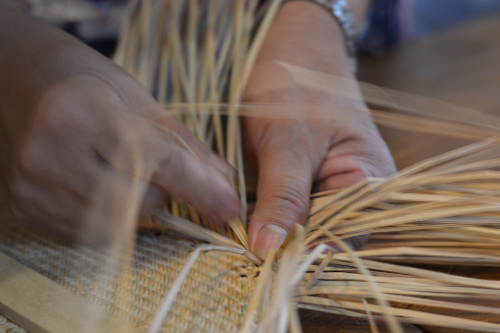
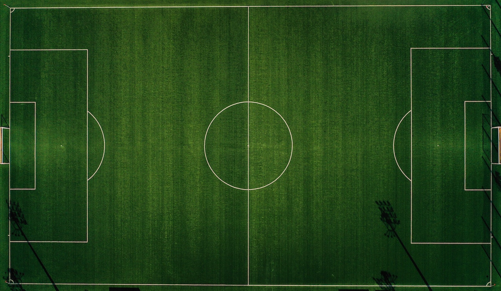

```{r setup, include=FALSE}
usethis::use_git_ignore(c("*.csv", "*.rds"))
options(htmltools.dir.version = FALSE)

library(knitr)
library(tidyverse)
library(xaringan)
library(fontawesome)
```

class: inverse, center, middle

# `r fa("fas fa-images", fill = "#fff")`

**View the slides:** 

[bretsw.com/eme6665-fs26-module6](https://bretsw.com/eme6665-fs26-module6)


---

class: inverse, center, middle

# `r fa("fas fa-share-nodes", fill = "#fff")` <br><br> Module 6 <br> Weaving Together Chapter One

---

# `r fa("fas fa-star", fill = "#fff")` Some Final Writing Tips

```{r, out.width = "600px", echo = FALSE, fig.align = "center"}

```

Your **Introduction** section is about a problem (a challenge or an opportunity).

--

This is where you tell your reader where you're headed.


---

# `r fa("fas fa-star", fill = "#fff")` Some Final Writing Tips

```{r, out.width = "600px", echo = FALSE, fig.align = "center"}

```

--

Your **Conceptual Foundation** section is like a streetlamp:

--

It illuminates part of the path, but not everything.

--

Your task is to pick the right streetlamp (foundation) that helps you guide your reader.


---

# `r fa("fas fa-share-nodes", fill = "#fff")` Bridge

```{r, out.width = "600px", echo = FALSE, fig.align = "center"}
include_graphics("img/bridge.jpg")
```

Your **Lit Review** section is a bridge between the problem (Introduction) and your study (Research Questions + Method)


---

# `r fa("fas fa-star", fill = "#fff")` Some Final Writing Tips

```{r, out.width = "600px", echo = FALSE, fig.align = "center"}

```

--

**Macro:** Follow your outline (and update your outline as necessary, then follow again)

---

# `r fa("fas fa-star", fill = "#fff")` Some Final Writing Tips

```{r, out.width = "480px", echo = FALSE, fig.align = "center"}

```

**Micro:** Follow your topic sentence (and revise your topic sentence as necessary, then follow again):

--

- Topic sentence that names the common theme of the paragraph

--

- Citations that offer specific supporting evidence of that theme


---

class: inverse, center, middle

# `r fa("fas fa-binoculars", fill = "#fff")` <br><br> Looking ahead

---

# `r fa("fas fa-calendar-day", fill = "#fff")` Semester schedule

- Module 1: Threads of Chapter One

- Module 2: Do You Trust Me?

- Module 3: Systematic Not Automatic

- Module 4: Synthesis Over Summary

- Module 5: Elements of Style (for Academic Writing)

- **Module 6: Weaving Together Chapter One**

- Module 7: Beauty is in Revision


---

# `r fa("fas fa-keyboard", fill = "#fff")` Final Assignment

```{r, out.width = "240px", echo = FALSE, fig.align = "center"}

```

--

**Objective:** Compile previously identified and evaluated research to compose a **complete** and **coherent** dissertation literature review.

--

Chapter One pulls together an Introduction, the Literature Review, a Conceptual Foundation, and Research Questions.

--

<hr>

--

- **Introduction**

--

  - Research topic

--

  - Problem

--

  - Purpose

---

# `r fa("fas fa-keyboard", fill = "#fff")` Final Assignment

```{r, out.width = "240px", echo = FALSE, fig.align = "center"}

```

**Objective:** Compile previously identified and evaluated research to compose a **complete** and **coherent** dissertation literature review.

Chapter One pulls together an Introduction, the Literature Review, a Conceptual Foundation, and Research Questions.

<hr>

- **Literature Review**

--

- **Conceptual Foundation**

--

- **Research Questions**

---

# `r fa("fas fa-keyboard", fill = "#fff")` Final Assignment

```{r, out.width = "240px", echo = FALSE, fig.align = "center"}

```

- **Key elements**

--

  - **Synthesis** of past research

--

  - **Significance** of past research

--

  - An argument

--

  - Alignment and focus

--

  - Narrative flow (topic sentences and transitions)

---

# `r fa("fas fa-keyboard", fill = "#fff")` Final Assignment

```{r, out.width = "240px", echo = FALSE, fig.align = "center"}

```

**Objective:** Compile previously identified and evaluated research to compose a **complete** and **coherent** dissertation literature review.

<hr>

- **Introduction**

- **Literature Review**

- **Conceptual Foundation**

- **Purpose & Research Questions**

---

# `r fa("fas fa-sitemap", fill = "#fff")` Order: Soccer Formations

```{r, out.width = "540px", echo = FALSE, fig.align = "center"}

```

--

- Introduction `r fa("fas fa-arrow-right", fill = "#782F40")` 
**Literature Review** `r fa("fas fa-arrow-right", fill = "#782F40")` 
Conceptual Foundation `r fa("fas fa-arrow-right", fill = "#782F40")` 
Purpose & Research Questions

--

- Introduction `r fa("fas fa-arrow-right", fill = "#782F40")`
Conceptual Foundation `r fa("fas fa-arrow-right", fill = "#782F40")` 
**Literature Review** `r fa("fas fa-arrow-right", fill = "#782F40")` 
Purpose & Research Questions

--

- Introduction `r fa("fas fa-arrow-right", fill = "#782F40")`
Conceptual Foundation `r fa("fas fa-arrow-right", fill = "#782F40")` 
Purpose & Research Questions 
`r fa("fas fa-arrow-right", fill = "#782F40")` **Literature Review**


---

class: inverse, center, middle

# `r fa("fas fa-question", fill = "#fff")` <br><br> Questions

<hr>

**What questions can I answer for you now?**

**How can I support you this week?**

<hr>

`r fa("envelope", fill = "#fff")` [bret.staudtwillet@fsu.edu](mailto:bret.staudtwillet@fsu.edu) | `r fa("globe", fill = "#fff")` [bretsw.com](https://bretsw.com) | `r fa("fab fa-github", fill = "#fff")` [GitHub](https://github.com/bretsw/)
